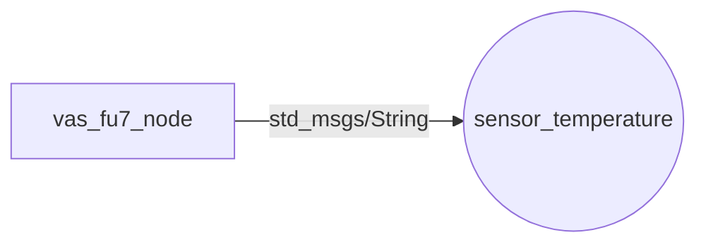

# vas_fu7_random csomag

Ez a csomag a ROS 2 beadandóhoz készült. Egy C++ Publisher node-ot tartalmaz, amely egy folyamatosan frissülő hőmérsékletszenzort szimulál.

## Node-Topic diagram



## Node és Topic kapcsolatok
* **Node neve:** `vas_fu7_node`
* **Topic neve:** `sensor_temperature`
* **Üzenet típusa:** `std_msgs/msg/String`
* **Leírás:** A node másodpercenként publikál egy folyamatosan ingadozó, szimulált hőmérséklet-értéket a `sensor_temperature` nevű csatornára.

## A build menete
A csomag lefordítása a munkakönyvtárból a colcon segítségével történik:

```bash
cd ~/ros2_ws
colcon build --packages-select vas_fu7_random
source install/setup.bash
```

## Futtatás
Futtatás közvetlenül:
```bash
ros2 run vas_fu7_random vas_fu7_node
```

Futtatás launch fájllal:
```bash
ros2 launch vas_fu7_random vas_fu7_launch.py
```
